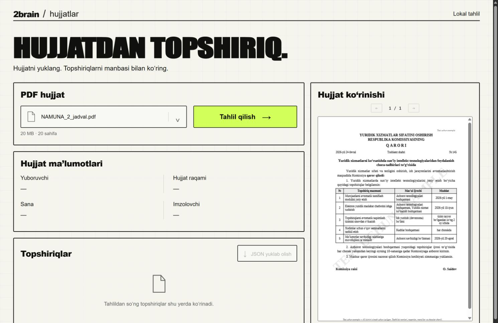
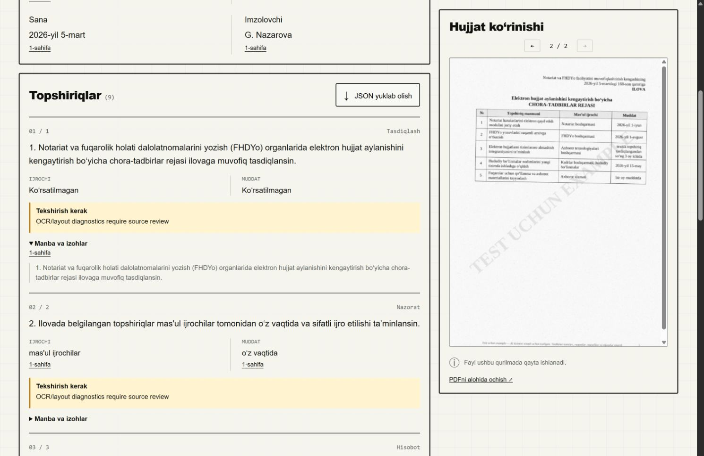

# Project guide — Task 2: Document task extraction

This guide explains the whole project in simple words: what the task asks, how the solution works step by step, how to run it, how quality was measured, and where it can fail.

Short version for running: [README.md](README.md). Design notes written before coding: [docs/design/task2-design.md](docs/design/task2-design.md).

---

## Contents

1. [The task](#1-the-task)
2. [Repository map](#2-repository-map)
3. [The main idea](#3-the-main-idea)
4. [Big picture](#4-big-picture)
5. [Technologies and why](#5-technologies-and-why)
6. [Step by step — what happens on upload](#6-step-by-step--what-happens-on-upload)
7. [Output JSON](#7-output-json)
8. [Privacy: how "no cloud" is enforced](#8-privacy-how-no-cloud-is-enforced)
9. [Model pinning](#9-model-pinning)
10. [Run the project](#10-run-the-project)
11. [How quality was measured](#11-how-quality-was-measured)
12. [Where it makes mistakes](#12-where-it-makes-mistakes)
13. [Next steps](#13-next-steps)
14. [Code map](#14-code-map)
15. [How to present the work](#15-how-to-present-the-work)
16. [Glossary](#16-glossary)

---

## 1. The task

From `Tasklar.docx`, task 2 ("Hujjatlarni tahlil qilish"):

- Input: official Uzbek PDF documents. A PDF can be a **text PDF** or a **scanned image**.
- Extract automatically:
  - **Document details (rekvizitlar):** sender organization, document number, date, signer.
  - **Tasks (topshiriqlar):** every task in the document, with its **deadline** (muddat) and **executor** (ijrochi). Tasks can be in paragraphs, numbered clauses or tables.
- **Web page:** the user uploads a PDF and presses **"Tahlil qilish"**. The page shows the details and the task list with deadlines and executors.
- **Restriction:** documents must **not** be sent to external cloud services.
- Deliver: code, results for the 12 supplied PDFs, and a short report (method, accuracy, errors).

## 2. Repository map

```text
.
├── README.md               Quick start, limits, API table
├── GUIDE.md                This file
├── run.ps1                 One command to start the app (Ollama + web server)
├── pyproject.toml, uv.lock Python dependencies of the web app
├── .env.example            Optional settings
├── model-profiles.json     Pinned model versions and file digests
├── src/doc_tasks/          Application code
│   └── web/                Web page: index.html, app.js, styles.css, bundled PDF.js
├── ocr-runtime/            OCR worker program, its locked dependencies, model hashes
├── web-dependencies/       How the bundled PDF.js was obtained (not used at runtime)
├── tests/                  71 automated tests
├── evaluation/
│   ├── gold/               Hand-checked correct answers for the 12 PDFs
│   ├── manifest.json       Which PDF is dev / test, text / scan
│   ├── results/            Measured outputs, report.md, summary, error ledger
│   │   ├── production/     Final JSON for all 12 PDFs (selected stack)
│   │   ├── frozen-v1/      First independent test results (kept for honesty)
│   │   └── *-final/, *-ocr-*/  Model and OCR comparison runs
│   ├── screenshots/        Browser screenshots
│   ├── report / audit / ui-qa .md
│   └── *.py                Helper scripts (summary, one-time migrations)
└── docs/design/            Design note written before coding
```

Folders **not** in Git (ignored), present on the prepared laptop:

| Folder | Content | Needed? |
|---|---|---|
| `.cache/` | Model weights (Ollama, PaddleOCR, Tesseract data), portable Ollama program | Yes |
| `.venv/` | Web app Python environment | Yes — `uv sync` creates it |
| `.venv-vl/` | GPU OCR environment (PaddleOCR-VL) | Yes for scans |
| `.venv-ocr/` | CPU OCR environment (PP-OCRv5, Tesseract) | Only for CPU OCR profiles |
| `.runtime/` | Tesseract program; temporary upload folder | Uploads are deleted after each job |
| `evaluation/source/` | The 12 original PDFs from `Files Task_2.rar` | Only for evaluation |

## 3. The main idea

A small local language model is good at *choosing*, but can invent text when it *writes*. So the design separates the work:

| Who | Does what |
|---|---|
| **Code (rules)** | Reads the PDF, finds the layout (paragraphs, clauses, table rows), and proposes **candidates**: every piece of text that *could* be a sender, number, date, signer, executor or deadline. Candidates are copied exactly from the document. |
| **Model (Tev1 4B)** | Answers short questions: "Is this passage a task?", "Which kind?", "Is candidate c17 responsible for this task — yes/no?", "Which candidate is the deadline — c3, c8 or unknown?" |
| **Code (checks)** | Builds the result only from chosen candidates, checks that every value appears word for word in the source, attaches page and position evidence, and marks unclear cases for human review. |

So the model **never writes output text**. Every value in the result is a verbatim copy from the PDF, with a link to where it came from.

## 4. Big picture

```text
Browser: choose PDF ─► "Tahlil qilish" ─► POST /api/analyze
                                              │
                         1. check PDF (≤20 MB, ≤20 pages, not encrypted, not broken)
                                              │
                         2. for each page:
                              has text?  ──yes──► read words + positions (pdfplumber)
                                 │no
                                 └──► render at 220 dpi ─► OCR worker (PaddleOCR-VL, GPU)
                                              │
                         3. build passages: header, paragraph, clause, table row, footer
                                              │
                         4. split compound passages into separate tasks (with model check)
                                              │
                         5. generate candidates (regex + layout)
                                              │
                         6. ask Tev1 narrow questions ─► choose candidates
                                              │
                         7. assemble + verify evidence ─► JSON result
                                              │
Browser: details, task cards, review flags, source page preview, "JSON yuklab olish"
```



## 5. Technologies and why

| Part | Job | Why |
|---|---|---|
| **pdfplumber / pypdf** | Read text PDFs with word positions and table lines. | Text PDFs need no OCR; exact text is better than OCR text. |
| **PaddleOCR-VL-1.6** (GPU) | Reads scanned pages, including tables. | Best of three tested OCR options; the only one that rebuilt all 23 table rows. |
| PP-OCRv5, Tesseract (CPU) | Alternative OCR profiles. | Measured for comparison; can be selected manually. |
| **Tev1 4B Q4_K_M** via **Ollama** | Decision model: answers multiple-choice and yes/no questions. | Best accuracy in tests; fits in the 6 GB GPU. |
| Tev1 0.8B, Qwen3.5 4B | Comparison models. | Measured; not used in production. |
| **FastAPI** | Web server and API. | Simple, typed, async. |
| **Pydantic** | Strict output schema. | Rejects results with missing evidence. |
| **PDF.js** (bundled locally) | Shows PDF pages in the browser. | No CDN; works offline. |
| **uv** | Installs exact locked Python packages. | Reproducible environment. |

## 6. Step by step — what happens on upload

### Step 1. Receive and check the file (`api.py`, `pdf.py`)

- Only **one job at a time**. A second upload gets **409**.
- The file is saved to a temporary folder `.runtime/uploads/doc-tasks-…/`.
- `validate_pdf()` rejects: > 20 MB or > 20 pages (**413**), encrypted or broken (**422**).
- The temporary folder is **always deleted** at the end, even on error or if the browser closes. Old leftover folders are deleted at server start.

### Step 2. Text or scan? (`pdf.read_pdf`)

For **each page** separately (mixed PDFs work):

- If the page has ≥ 30 characters of text → **native** reading. Words keep their coordinates. Tables are found by their ruling lines; each cell gets an ID like `p1-table0-r2-c3`.
- Otherwise → the page is rendered to an image (220 dpi) and sent to **OCR**.

### Step 3. OCR (`ocr.py`, `ocr-runtime/worker.py`, `ocr_layout.py`)

- OCR runs in a **separate process** with its **own Python environment** (`.venv-vl`). Reason: PaddlePaddle GPU packages conflict with the web app packages and with the CPU OCR packages (`.venv-ocr`).
- The worker loads PaddleOCR-VL-1.6 from local files, reads the page, finds table grid lines with OpenCV, and writes JSON (text blocks, table cells with positions).
- **GPU sharing:** the laptop has 6 GB of GPU memory. OCR needs about 5.9 GB. So before OCR the app asks Ollama to unload the language model. The OCR process exits after each page, which frees the GPU. Then Tev1 loads again for the decisions.

### Step 4. Build passages (`structure.py`)

Lines are grouped into **passages**, each with a type:

| Type | How it is detected |
|---|---|
| `header` | Page 1, top 24%, no number, no action verb |
| `clause` | Starts with `1.`, `2)` … |
| `paragraph` | Other text blocks (split at gaps and sentence ends) |
| `table_row` | One table row; cells know their column role |
| `footer` | Bottom 8% of the page, or starts with `Ijrochi:` / `Tel.:` (the preparer, **not** the executor) |
| `heading` | `ILOVA`, `QARORI` and similar |

Table columns get roles from their header words (`roles.py`): `muddat` → deadline, `ijrochi` / `mas'ul` → executor, `topshiriq` / `chora-tadbir` → instruction, `natija` → deliverable.

### Step 5. Split compound passages (`segmentation.py`)

One paragraph can contain two tasks: "*X bo'limi … ishlab chiqsin; Y boshqarmasi … taqdim etsin.*"

- The code finds possible cut points (`;`, sentence end, ` hamda `, ` va `) — but only if **both** sides contain an action verb (`…sin`, `so'raymiz`, …).
- "Develop a draft **and** submit it" stays **one** task (`_same_draft()` protection).
- Tev1 answers `split` or `preserve`. If the two parts have different explicit subjects (different executors), they are split; if Tev1 disagreed, a review flag is added.
- Split parts keep a link (`parent_id`) to the original passage.

### Step 6. Generate candidates (`candidates.py`)

Regular expressions and layout rules collect **every possible value**, copied verbatim:

| Field | Examples of patterns |
|---|---|
| Sender | Upper-case lines in the header, words ending in `…NING`, multi-line header blocks |
| Number | `№ 121`, `No 05/1234` |
| Date | `2026-yil 10-fevral`, `10.02.2026` |
| Signer | Initials + surname: `M. Tursunov` |
| Executor | Phrases ending in an organization word (`departamenti`, `boshqarmasi`, `markazi` …), table executor cells |
| Deadline | Dates, `bir oy muddatda`, `har chorakda` (recurring), `o'z vaqtida`, `doimiy`, table deadline cells |

### Step 7. Ask the model (`extract.py`, `decisions.py`)

The app sends questions to the local Ollama server at `http://127.0.0.1:11435/v1/systemone`. Simplified example:

```json
{
  "model": "tev1:4b-q4_K_M",
  "state": { "passage": "1. Ro'yxatga olish departamenti … bir oy muddatda ishlab chiqsin …" },
  "questions": {
    "deadline": {
      "type": "choice",
      "instructions": "Choose the original deadline expression for THIS obligation. … Do not calculate dates. … If absent or ambiguous choose unknown.",
      "criteria": { "c3": "bir oy muddatda", "c8": "2026-yil 10-fevral", "unknown": "…" }
    }
  }
}
```

The answer is only an option ID (`"c3"`) or a yes/no probability. Option IDs that were not offered are rejected.

Questions asked:

| Question | Type | Purpose |
|---|---|---|
| `sender`, `number`, `date`, `signer` | choice | Document details (from the page-1 header and the end of the letter) |
| `obligation` | yes/no | Is this passage a task? |
| `kind` | choice | execution / approval / oversight / reporting / other |
| `responsible` | yes/no (per candidate) | Is this organization an executor? Several executors are allowed. |
| `deadline` | choice | Which candidate is the deadline? |
| `default_applies` | yes/no | Does a general rule ("*tasks without a deadline must be done within …*") apply to this task? |
| `task_boundary` | choice | Split or keep together (Step 5) |

**Safety rules around the model:**

- Table rows and passages with clear action verbs are **always kept** as tasks, even if the model says "no" — then a review flag is added. (Missing a task is worse than a flagged extra.)
- An executor is accepted if the model says yes **or** the structure clearly shows it (table executor cell, sentence starts with the unit). Without the model's yes → `needs_review`.
- Table candidates must come from the **same row and cell**.
- More than 23 candidates → a **tournament** (groups of 23, winners compete again), not cutting the list.
- Dates are **never calculated**. "Bir oy muddatda" stays as written.
- The signer and the footer preparer (`Ijrochi: …`) become executors **only** if the text explicitly assigns them a task.

### Step 8. Assemble and verify (`extract.py`, `schema.py`)

- Every value must be a **verbatim substring** of its source spans (`validate_grounding`).
- Every `source_id` must exist.
- Each field gets a status:

| Status | Meaning |
|---|---|
| `supported` | Value found and copied from the source. **Grounded, not guaranteed correct.** |
| `not_specified` | The document does not give this value. |
| `needs_review` | Unclear: model and structure disagree, or several candidates fit. A human should check. |

### Step 9. Show the result (`web/app.js`)

- Details grid: Yuboruvchi, Hujjat raqami, Sana, Imzolovchi.
- One card per task: number / clause, kind, instruction, Ijrochi, Muddat, yellow "Tekshirish kerak" box with reasons.
- "Manba va izohlar": source text and page buttons. A page button shows that PDF page in the browser (from the browser's own copy — the server copy is already deleted).
- "JSON yuklab olish": download the full result.
- While the job runs, the page asks `GET /api/status` every second and shows the real stage (reading → OCR → extracting → validating). No fake percentages.



## 7. Output JSON

Real values from `evaluation/results/production/NAMUNA_1_abzats.json`, shortened:

```json
{
  "metadata": {
    "sender": {"text": "HUQUQIY XIZMATLARNI RAQAMLASHTIRISH MILLIY AGENTLIGI KENGASHINING",
               "source_ids": ["p1-line1-f0", "p1-line2-f0"], "status": "supported"},
    "number": {"text": "121", "source_ids": ["p1-line4-f2"], "status": "supported"},
    "date":   {"text": "2026-yil 10-fevral", "source_ids": ["p1-line4-f0"], "status": "supported"},
    "signer": {"text": "M. Tursunov", "source_ids": ["p1-line26-f1"], "status": "supported"}
  },
  "tasks": [
    {
      "id": "task-1",
      "kinds": ["execution"],
      "instruction": {"text": "1. Ro‘yxatga olish departamenti … ishlab chiqsin va Kengash muhokamasiga kiritsin.",
                      "source_ids": ["p1-line10-f0", "p1-line11-f0", "p1-line12-f0"], "status": "supported"},
      "executors": [{"text": "Ro‘yxatga olish departamenti", "source_ids": ["…"], "status": "supported"}],
      "deadline":  {"text": "bir oy muddatda", "source_ids": ["…"], "status": "supported"},
      "clause_ref": "1",
      "review_reasons": []
    }
  ],
  "sources":   [{"id": "p1-line0-f0", "page": 1, "text": "…", "bbox": [475.3, 50.5, 546.8, 59.5], "parent_id": null}],
  "warnings":  [],
  "provenance": {"model": "…", "model_digest": "…", "page_modes": ["native"], "stack_sha256": "…", "decision_trace": ["…"]}
}
```

`provenance.decision_trace` records every question and every model answer — the full audit trail.

API summary:

| Route / code | Meaning |
|---|---|
| `POST /api/analyze` | Multipart field `file`; returns the JSON above |
| `GET /api/status` | Busy + current stage (no document text) |
| `GET /api/health` | Model and OCR availability |
| 409 / 413 / 422 / 503 | Busy / too large / invalid PDF / model or OCR unavailable |

## 8. Privacy: how "no cloud" is enforced

1. **Network guard** (`network.py`): inside the app and the OCR worker, any socket connection to a non-local address raises an error.
2. The model URL must be `127.0.0.1` / `localhost`; HTTP clients ignore proxy settings.
3. `run.ps1` sets `OLLAMA_NO_CLOUD=1`, `HF_HUB_OFFLINE=1`, `TRANSFORMERS_OFFLINE=1`.
4. PDF.js, fonts and scripts are served from the app itself; no CDN.
5. Uploaded PDFs are deleted after each job; nothing is stored.

This is protection at application level, not an operating-system firewall.

## 9. Model pinning

`model-profiles.json` stores the exact Ollama version (0.40.3), model tags and **file digests**. Before each analysis the app compares the installed model digest with this file. A different or unknown model is refused. Qwen cannot be used in production by mistake. OCR model files are pinned by SHA-256 in `ocr-runtime/models-lock.json`.

The "stack fingerprint" (`benchmark.code_hash()`) hashes the decision code, the OCR worker and both lock files. The measured results record this fingerprint, so anyone can check that results came from this exact code.

## 10. Run the project

On the prepared laptop, from the repository root:

```powershell
./run.ps1
```

Then open <http://127.0.0.1:8132>.

`run.ps1` does this:

1. Sets offline and single-model Ollama settings (port **11435**, model folder `.cache/ollama-models`).
2. Starts the portable Ollama from `.cache/runtime/ollama/` if it is not already running (PID saved in `.cache/runtime/ollama.pid`).
3. Starts the web app: `uv run doc-tasks serve --port 8132`.

Other commands:

| Command | Purpose |
|---|---|
| `uv run doc-tasks health` | Check model and OCR are available |
| `uv run doc-tasks analyze file.pdf --output result.json` | Analyze without the browser |
| `uv run doc-tasks benchmark-ocr --engine paddle-vl --split dev` | Measure OCR quality |
| `uv run doc-tasks compare --mode native --split dev` | Compare the 3 models |
| `uv run doc-tasks freeze` | Lock the configuration before running the test split |
| `uv run pytest -q` | Run the 71 tests |
| `uv run ruff check .` | Lint |

Setup on a new machine (needs internet once): see [README.md](README.md) and [ocr-runtime/README.md](ocr-runtime/README.md).

Tested hardware: Windows, Python 3.12, NVIDIA RTX 4050 laptop (6 GB), 16 GB RAM.

**Memory note.** Scanned PDFs need the GPU OCR worker, which needs several GB of free RAM and almost all 6 GB of GPU memory. Close heavy programs (Docker Desktop, many browser tabs) before a scanned-PDF demo. If RAM is too low, the API returns **503** "OCR worker failed". Text PDFs need much less memory.

## 11. How quality was measured

1. **Gold answers first.** All 12 supplied PDFs (6 documents × text + scan) were annotated by hand **before** any model run: 46 tasks per mode, with executors, deadlines and kinds. Files: `evaluation/gold/`.
2. **Split.** Development: NAMUNA_1, NAMUNA_2, xat_1, xat_3 (30 tasks). Held-out test: NAMUNA_3, xat_2 (16 tasks). Text and scan of the same document stay in the same split.
3. **Choose OCR** on development scans only (`benchmark-ocr`).
4. **Choose the model** on development data: the three models get identical inputs (`compare`).
5. **Freeze** and run the test split.
6. **Matching:** a predicted task matches a gold task if the instruction text is ≥ 65% similar. Then executors, deadline, kind and details are compared exactly (ignoring case, apostrophe form and spaces).

**Results for the selected stack (Tev1 4B + PaddleOCR-VL), all 12 documents:**

| | Text PDFs | Scanned PDFs |
|---|---:|---:|
| Tasks found | **46/46**, 0 extra | **46/46**, 0 extra |
| Document details | **24/24** | **24/24** |
| Executor sets correct | **46/46** | 38/46 |
| Deadlines correct | **46/46** | 44/46 |
| Instruction wording exact | 46/46 | 36/46 |
| Kind label correct | 42/46 | 42/46 |

**Model comparison (development set, text PDFs):**

| Model | Details correct | Kind errors | Median time / document | Peak GPU (MiB) |
|---|---:|---:|---:|---:|
| **Tev1 4B** (selected) | 16/16 | 2 | 16.8 s | 2881 |
| Tev1 0.8B | 14/16 | 5 | 6.5 s | 965 |
| Qwen3.5 4B | 16/16 | 3 | 24.4 s | 3751 |

On the test documents Tev1 4B had no errors on text PDFs; the other two models had some.

**OCR comparison (key strings found in OCR text, development scans):** PaddleOCR-VL 70/76, Tesseract 62/76, PP-OCRv5 51/76. Only VL rebuilt all 23 table rows. VL takes 69–137 s per document on the GPU.

**Important honesty note.** The first frozen run (`evaluation/production-freeze-v1.json`, `evaluation/results/frozen-v1/`) is the truly independent test result: text 16/16 tasks with no errors; scans 16/16 tasks with one duplicate, 7/8 details, 4 executor and 2 deadline errors. After looking at those errors, general parser bugs were fixed (apostrophe variants, OCR table line breaks, damaged number markers). The current numbers on the test documents are therefore marked **"exposed"** — they are not independent validation. Both versions are kept.

Full report: [evaluation/results/report.md](evaluation/results/report.md). Requirement checklist: [evaluation/decision-stack-audit.md](evaluation/decision-stack-audit.md). Browser test: [evaluation/ui-qa.md](evaluation/ui-qa.md).

## 12. Where it makes mistakes

- **All remaining scan errors come from OCR**, not from the model: damaged words like `martdan`, `muassasalarida`, unit names, `Loyihaga` instead of `Loyiha`. Evidence: `evaluation/results/manual-adjudication.json`.
- **OCR errors can be silent.** `supported` only means "copied from the OCR text". A wrong OCR word is copied too. Always check scanned results against the page preview.
- **Kind labels** (execution vs reporting, etc.) are wrong in 4 of 46 tasks.
- **Subject detection** uses Uzbek Latin patterns, not a full grammar parser. Unusual sentence structure can confuse task splitting.
- **Not tested:** handwriting, Cyrillic documents, complex merged table cells, other document types.
- Only 6 document families were available, so the numbers are a small sample, not a general accuracy guarantee.
- Slow on scans (1–2 minutes per document) because OCR and the model share one 6 GB GPU.
- The optional Tesseract CPU profile does not start on this laptop: its environment in `.runtime/tesseract` lacks `libcurl.dll`. The production OCR (PaddleOCR-VL) does not use it.

## 13. Next steps

- Collect new, unseen documents for a truly independent test.
- Combine two OCR engines (e.g. VL for tables, Tesseract for plain paragraphs — Tesseract was better on one paragraph scan).
- Calibrate kind labels on more documents.
- Add editing of results in the browser and Excel export.

## 14. Code map

`src/doc_tasks/`:

| File | Role |
|---|---|
| `api.py` | Web server: routes, one-job lock, upload handling, cleanup, error codes |
| `runtime.py` | Production pipeline `analyze_pdf()`; settings; model digest check; health check |
| `pdf.py` | PDF validation; native text/table reading; native vs OCR decision per page |
| `ocr.py` | Starts the OCR worker process; reads its JSON |
| `ocr_layout.py` | Converts PaddleOCR-VL output (incl. HTML tables) into spans and cells |
| `structure.py` | Groups lines into passages (header, clause, table row, footer…) |
| `roles.py` | Table column roles from header words |
| `segmentation.py` | Splits compound passages into separate tasks |
| `language.py` | Detects Uzbek action verbs (`…sin`, `so'raymiz`) |
| `candidates.py` | Generates verbatim candidates for every field |
| `decisions.py` | Talks to Ollama (`/v1/systemone` for Tev1, `/api/chat` for the Qwen comparison) |
| `audit.py` | Records every question and answer (decision trace) |
| `extract.py` | Main extraction logic: asks questions, applies safety rules, assembles the result |
| `schema.py` | Strict output models and evidence checks |
| `network.py` | Blocks non-local network connections |
| `evaluate.py` | Compares a result with gold answers |
| `benchmark.py` | OCR benchmark, model comparison, stack fingerprint |
| `cli.py` | `doc-tasks` command |
| `web/` | `index.html`, `app.js`, `styles.css`, bundled PDF.js |

Other:

| File | Role |
|---|---|
| `ocr-runtime/worker.py` | OCR worker; runs inside `.venv-vl` or `.venv-ocr` |
| `ocr-runtime/requirements-*.txt` | Locked OCR packages (CPU / GPU) |
| `ocr-runtime/models-lock.json` | SHA-256 of OCR model files |
| `evaluation/summarize.py` | Builds `summary.json`, `error-ledger.json`, `production/` |
| `evaluation/rebuild_passages.py`, `canonicalize_fingerprint.py` | One-time migrations already applied to stored results; kept for audit |

Tests (`tests/`, 71 tests): API limits and cleanup, PDF reading (native, mixed, broken, encrypted), table cells, candidates, model contract, decision stack, splitting, review regressions, schema, network guard, freeze, evaluation metrics.

## 15. How to present the work

The assignment asks the candidate to explain six things:

| Expected point | Short answer |
|---|---|
| **1. How I understood the task** | Extract details + every task with executor and deadline from text and scanned PDFs, fully offline, with a web page. |
| **2. Approach / architecture** | Rules find structure and candidates; a small local model only chooses; code verifies evidence. Text pages read directly, scanned pages through local OCR. |
| **3. Why these technologies** | Local-only requirement; PaddleOCR-VL won on tables; Tev1 4B won on accuracy and fits the 6 GB GPU; Pydantic enforces evidence. |
| **4. Problems and limits** | Silent OCR word errors; small sample (6 families); slow scans; kinds 42/46; high memory use for scans. |
| **5. How it was checked** | Gold made before inference, dev/test split, 3 models × 3 OCR engines compared, freeze, 71 tests, browser QA, honest "exposed" label. |
| **6. How to continue** | New documents, OCR ensemble, kind calibration, editing + Excel export. |

**Demo order (about 5 minutes):**

1. Close heavy programs. Run `./run.ps1`, open <http://127.0.0.1:8132>.
2. Upload a text PDF with a table (`NAMUNA_2_jadval.pdf`) → show tasks, executors, deadlines, evidence buttons.
3. Upload its scanned version → show the OCR result and a review flag → download JSON.
4. Show the tables in `evaluation/results/report.md` and say clearly what is measured and what is not.

## 16. Glossary

| Term | Meaning |
|---|---|
| **OCR** | Optical character recognition: reading text from an image. |
| **Native page** | A PDF page that already contains text (no OCR needed). |
| **Passage** | A block of text with a type (clause, table row, footer…). |
| **Span / source ID** | A piece of text with page and position; every result value points to spans. |
| **Candidate** | A verbatim piece of text that could be a field value. |
| **Grounded** | The value appears word for word in the source. |
| **Gold** | Hand-checked correct answers used for evaluation. |
| **Dev / test split** | Dev documents are used for choices; test documents are measured at the end. |
| **Freeze** | Recording the exact code and model version before testing, so the test cannot influence choices. |
| **Exposed test** | A test set whose errors were already seen; results on it are no longer independent. |
| **Ollama** | A local program that runs language models on the laptop. |
| **Tev1** | The decision model (4B parameters, 4-bit quantized). |
| **Quantization (Q4_K_M, Q8_0)** | Storing model weights with fewer bits so the model fits in less memory. |
